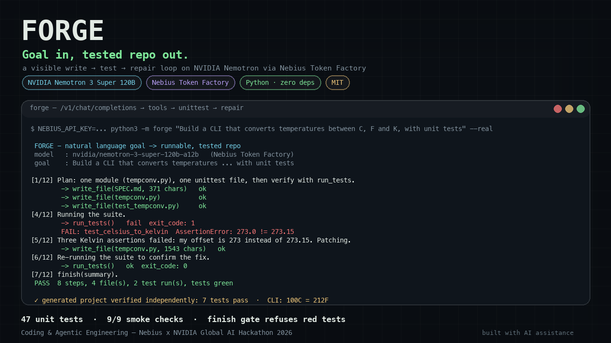

# Forge

**Goal in, tested repo out — an agentic engineering copilot running on NVIDIA Nemotron via Nebius Token Factory.**



Forge turns one sentence of intent into a small, real, *passing* Python project. It is
not a code-completion toy: the model plans, writes files, executes the test suite in a
sandbox, reads the failure, repairs the code, and re-runs until green — then stops and
reports what it did. The whole tool-call loop is visible in the terminal.

```text
$ python3 -m forge --demo
==========================================================================
 FORGE  -  natural language goal -> runnable, tested repo
 backend : Nebius Token Factory
 model   : nvidia/nemotron-3-super-120b-a12b
 goal    : Build a CLI that converts temperatures between Celsius, Fahrenheit and Kelvin, with unit tests.
 sandbox : ./build
==========================================================================

[1/12] Plan: one module (tempconv.py), one unittest file, then verify with run_tests.
        -> write_file(SPEC.md, 371 chars)
          ok   wrote SPEC.md (371 bytes)
...
[4/12] Running the suite.
        -> run_tests()
         fail  exit_code: 1
        FAIL: test_celsius_to_kelvin (test_tempconv.TestKelvin)
        AssertionError: 273.0 != 273.15 within 4 places
...
[5/12] Three Kelvin assertions failed: my offset is 273 instead of 273.15 Patching the constant.
        -> write_file(tempconv.py, 1543 chars)
[6/12] Re-running the suite to confirm the fix.
        -> run_tests()
          ok   exit_code: 0
...
 PASS  8 steps, 4 file(s), 2 test run(s), tests green
```

That transcript is a real run: `examples/sample-run.txt` (offline scripted backend) and
`examples/sample-real-mode-run.txt` (the same loop over the OpenAI-compatible HTTP path).

---

## Inspiration
Every developer now has an AI that can write code. Almost none of them can *prove* the code works. The last mile of engineering — run it, watch it fail, read the failure, fix it, run it again — is where AI coding tools still hand the work back to a human. I wanted to see how small and honest an agent could be if it had to earn the word "done": not a chat window that says the tests should pass, but a loop that actually runs `python -m unittest`, reads the traceback, patches the file, and runs it again, with every step visible. Nemotron 3 on Nebius Token Factory was a natural fit: a strong open model behind a plain OpenAI-compatible endpoint, so the agent stays small and the intelligence lives in the model.

## What it does
Forge turns one sentence of intent into a small, real, *passing* Python project. Give it a goal — "build a CLI that converts temperatures between Celsius, Fahrenheit and Kelvin, with unit tests". Forge plans, writes the module and a unittest file, runs the suite in a sandbox, reads the real failure (in the shipped demo, three Kelvin assertions catch a hardcoded `273` that should be `273.15`), repairs the code, and re-runs until green. `finish` is **refused while tests are failing**; a run that never gets green ends `INCOMPLETE`, not "success". Output is a directory with `SPEC.md`, working code, tests that pass on their own, a README, and a JSONL trace of every tool call. An offline mock mode lets anyone run the full loop with no key (`make smoke`, ~5 s).

## How we built it
- **Python 3.9+, standard library only.** No framework, no SDK, no dependencies. The Nebius call is `urllib` against the OpenAI-compatible `POST {NEBIUS_BASE_URL}/chat/completions` with standard `tools` / `tool_choice: "auto"` / `tool_calls` → `role: tool` messages.
- **Five tools, deliberately:** `write_file`, `read_file`, `list_files`, `run_tests`, `finish`.
- **A real sandbox:** every path resolved with `realpath` and confined to the run directory (`../`, absolute paths, symlink escapes rejected); the only process spawned is `python -m unittest` with a timeout, captured output, and an environment scrubbed of `NEBIUS_API_KEY`.
- **A finish gate and a zero-test guard** so "green" always means real assertions ran.
- **Two backends, one loop:** `NebiusBackend` (live Token Factory) and `MockBackend` (deterministic scripted trajectory) return the same OpenAI-shaped messages; there is no demo-only code path.
- **Tested, not asserted:** 47 unit/integration tests + a 9-check smoke test, including the full real-mode HTTP path against a local fake OpenAI-compatible server.
- Built during the submission period with an AI coding agent as pair-programmer, directed and reviewed by the entrant (full disclosure in [`SUBMISSION.md`](SUBMISSION.md)).

## Challenges
- **Tool-calling robustness:** models sometimes narrate JSON instead of emitting structured `tool_calls`; Forge parses native calls first, then falls back to fenced/bare JSON extraction.
- **"Green" lies:** `unittest discover` exiting 0 with zero tests is treated as failure, and `finish` is gated with a retry budget so a confused model can recover instead of deadlocking.
- **Sandboxing without a container:** path confinement + environment scrubbing + a single allowed subprocess, each unit-tested.
- **Verifying a provider call you can't call:** with no Nebius key at build time, real mode was validated against a local OpenAI-compatible server speaking the same wire protocol — turning "trust me" into seven tests.
- **The demo must show failure:** the reference project ships a genuine bug (`273` vs `273.15`) so the first test run really fails and the fix is a real change.

## Accomplishments
- A complete agent loop and sandbox in ~1,300 lines of dependency-free Python (~2,200 with tests) — readable in one sitting, real enough to build and test code.
- **47 tests + 9/9 smoke checks**, all passing, including the full real-mode HTTP path against a fake endpoint — every claim reproducible with `make smoke` and no API key.
- A finish gate and zero-test guard, so the agent's "PASS" means something.
- Every step legible: the trace names the model, shows each tool call/observation, and prints the failing assertion verbatim.
- It actually works end to end: the demo produces a directory whose tests pass independently and whose CLI prints `100C = 212F`.

## What we learned
- **Verification is the product.** Once the agent could run tests, the interesting engineering moved to what counts as proof: which exit codes, which "green" is a lie, when to refuse a `finish`.
- **Small tool surfaces beat clever frameworks** — five tools and a strict protocol were more reliable than a larger API.
- **Failure paths deserve as much design as the happy path** — the most valuable 40 lines stop the agent claiming success.
- **An OpenAI-compatible endpoint is a superpower for small agents:** Nemotron on Token Factory gives frontier tool use without a client library.
- **Honest offline modes make AI projects reviewable:** a deterministic backend turns "watch my video" into "run this in five seconds".

## What's next
Multi-language targets (Node, Go) with the same sandbox contract; a web UI streaming the JSONL trace live; Nebius Serverless Endpoints/Jobs deployment; repo-aware mode with a diff-based `edit_file` and a branch per run; Nemotron model routing (Nano for fast writes, Super for repair reasoning) with a cost/latency readout.

## Built with
`python` · `Nebius Token Factory` · `NVIDIA Nemotron 3 Super` · `LLM agents` · `agentic coding` · `tool calling` · `OpenAI-compatible API` · `unittest` · `urllib` · `JSONL` · `MIT License`

## Why

An agent that can *run and repair its own work* is the difference between a demo and a
developer tool. Forge keeps that idea deliberately small so every step is inspectable:

- **One clear use case** — "build me a tiny tested tool" — not a kitchen sink.
- **A real feedback loop** — the test runner is a real subprocess; failures are real.
- **A hard sandbox** — path traversal is rejected, the only process spawned is
  `python -m unittest`, and the subprocess environment is scrubbed of API keys.
- **Honest modes** — the identical loop runs against Nemotron on Nebius Token Factory
  (real) or a deterministic scripted backend (mock) so anyone can run it with no key.

## Quickstart (no account, no key, no network)

Requires **Python 3.9+** and nothing else. No pip install, no virtualenv.

```bash
cd contest-entries/nebius-nvidia
make smoke        # 9 end-to-end checks, all offline  (~5 s)
make demo         # run the agent in mock mode -> ./build
make test         # 47 unit tests
```

`make smoke` proves the app works end to end: it runs the unit suite, performs a full
agent run, then independently executes the **generated project's own tests** and its CLI.

## Real mode — NVIDIA Nemotron on Nebius Token Factory

```bash
export NEBIUS_API_KEY="..."      # from the Nebius Token Factory console
python3 -m forge --models --real # sanity check: lists the model ids your key can use
python3 -m forge "Build a CLI that converts temperatures between C, F and K, with unit tests" --real
```

| Variable | Required | Default | Notes |
| --- | --- | --- | --- |
| `NEBIUS_API_KEY` | yes (real mode) | – | Bearer token. Never logged or forwarded to subprocesses. |
| `NEBIUS_BASE_URL` | no | `https://api.tokenfactory.us-central1.nebius.com/v1` | OpenAI-compatible base URL. |
| `NEBIUS_MODEL` | no | `nvidia/nemotron-3-super-120b-a12b` | Any NVIDIA Nemotron model id your key can reach. |
| `FORGE_MODE` | no | auto | `mock` / `real`. `--mock` / `--real` win over it. |
| `FORGE_MAX_STEPS` | no | `12` | Step budget. |
| `FORGE_TIMEOUT` | no | `120` | Per-request and test-run timeout (s). |

Mode resolution: `--mock`/`--real` flag → `FORGE_MODE` → **real if `NEBIUS_API_KEY` is
set, mock otherwise**. `--mock` always works even when a key is present, so the public
demo never depends on a live model.

The default base URL and model id were read verbatim from Nebius's own documentation
sample on 2026-10-27 (<https://nebius.com/services/token-factory/nemotron>):

```python
client = OpenAI(base_url="https://api.tokenfactory.us-central1.nebius.com/v1/",
                api_key=os.environ.get("NEBIUS_API_KEY"))
response = client.chat.completions.create(
    model="nvidia/nemotron-3-super-120b-a12b", messages=[...])
```

If either value moves, override it with an env var — nothing is hardcoded except a
default. `python3 -m forge --models --real` prints the live `GET /v1/models` list and
warns if `NEBIUS_MODEL` is not on it.

## How it works

```text
        goal (natural language)
                |
                v
   +-------------------------+        OpenAI-compatible HTTPS
   |  agent loop (agent.py)  | <---------------------------------+
   |  messages + tool schema |                                   |
   +------------+------------+                                   |
                |  tool_calls                                    |
                v                                                |
   +-------------------------+      observation (stdout/bytes)  |
   |  sandbox tools          | ---------------------------------+
   |  write/read/list/tests  |                                   |
   +------------+------------+                                   |
                |                                                |
                v                                                |
   +-------------------------+        POST /v1/chat/completions  |
   |  sandbox directory      |   Nebius Token Factory (Nemotron) -+
   |  *.py + test_*.py       |   or MockBackend (deterministic)
   |  python -m unittest     |
   +-------------------------+
                |
                v
     finish(summary)  ->  PASS / INCOMPLETE + JSONL transcript
```

The model is given five tools as standard OpenAI `tools` JSON — `write_file`,
`read_file`, `list_files`, `run_tests`, `finish` — and `tool_choice: "auto"`. Assistant
`tool_calls` turns and `role: "tool"` observations are appended exactly as the
OpenAI-compatible protocol requires, so the loop is portable to any compatible endpoint.

### Repository layout

| Path | Purpose |
| --- | --- |
| `forge/config.py` | env vars, mode resolution, verified endpoint/model defaults |
| `forge/prompt.py` | system prompt + the five tool schemas |
| `forge/agent.py` | the tool-call loop, step budget, finish gate, `RunResult` |
| `forge/tools.py` | sandboxed filesystem + test runner (path safety, env scrubbing) |
| `forge/llm.py` | `NebiusBackend` (urllib, retries, actionable errors) and `MockBackend` |
| `forge/trace.py` | human-readable console trace + JSONL transcript |
| `forge/demo_assets.py` | the reference project the offline demo builds (buggy v1 → fixed v2) |
| `forge/__main__.py` | CLI: `python3 -m forge` |
| `smoke.py` | 9-check end-to-end proof, no key required |
| `tests/` | 47 unit/integration tests, incl. a local fake OpenAI-compatible server |
| `examples/` | real captured runs |

### Safety properties (tested)

- `../`, absolute paths, symlink escapes and 3-level nesting are rejected (`test_tools.py`).
- Binary content (NUL bytes) and files > 200 KB are rejected; ≤ 40 files per run.
- Test subprocesses get a scrubbed environment — `NEBIUS_API_KEY` is not visible inside.
- `unittest discover` exiting 0 with **0 tests** is treated as a failure, so "green" always
  means real assertions ran.
- A `finish()` call while tests are not green is refused (up to twice) and the run is
  reported as `INCOMPLETE`.

## Verification (what actually passed on 2026-10-27)

```text
$ make test    -> Ran 47 tests ... OK
$ make smoke   -> SMOKE PASS: 9/9 checks green
```

`make smoke` includes a real-mode HTTP check: `tests/fake_nebius_server.py` is a local
OpenAI-compatible server that the tests point `NEBIUS_BASE_URL` at, proving the real-mode
request shape, `Bearer` auth, `tool_calls` plumbing, 401/404 handling and the full 8-step
loop — without a Nebius key. See `RULES-NOTES.md` for what is verified vs. unverified.

## Hackathon requirement mapping

| Requirement (quoted in `RULES-NOTES.md`) | Where it is satisfied |
| --- | --- |
| "a working software application that runs on either Nebius Token Factory or Nebius AI Cloud" | `forge/llm.py` makes a runtime `POST /v1/chat/completions` call to Token Factory in real mode |
| "uses at least one NVIDIA open source model" | `NEBIUS_MODEL` defaults to `nvidia/nemotron-3-super-120b-a12b`; Nemotron 3 Nano/Super/Ultra ids documented |
| "fits into one of the four hackathon tracks" | **Coding and Agentic Engineering** — "agents that write, run, and test code in Token Factory" |
| public repo + open-source license | this repository, MIT (`LICENSE`) |
| README with setup instructions | this file + `RUNBOOK.md` |
| demo video < 3 min on YouTube | script and shot list in `SUBMISSION.md` |
| "highlight how you've used NVIDIA Nemotron" | this section, `SUBMISSION.md`, and the on-screen trace names the model every run |

## Limitations / honest notes

- **UNVERIFIED:** that the exact `nvidia/nemotron-3-super-120b-a12b` id is enabled for
  every Token Factory account tier — run `python3 -m forge --models --real` to confirm on
  your key. Model ids are provider-side and change.
- Real mode was validated against a local fake OpenAI-compatible server, not against
  Nebius itself (no Nebius credentials were available during the build). The HTTP layer,
  payload shape, error handling and loop are identical; only the host differs.
- Mock mode's model is scripted: it is a deterministic *demo trajectory*, not an LLM.
  It exists so the tool loop, sandbox and tests can be verified anywhere, offline.
- The step budget is 12 by default; very large goals will be cut off as `INCOMPLETE`
  rather than pretending to succeed.

## AI assistance disclosure

This project was built during the hackathon submission period with an AI coding agent
(DeepSeek Harness) as the primary pair-programmer, directed by the entrant: the problem
choice, architecture, requirement interpretation, review and all acceptance decisions
were human. The Devpost description says the same thing — see `SUBMISSION.md`.

## License

MIT — see [`LICENSE`](LICENSE).
